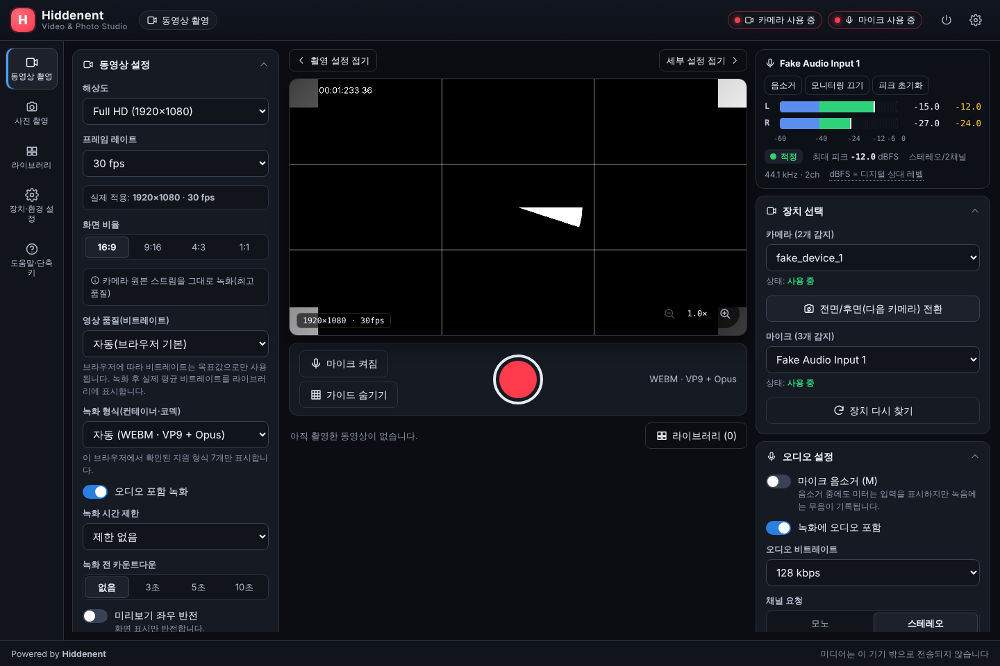
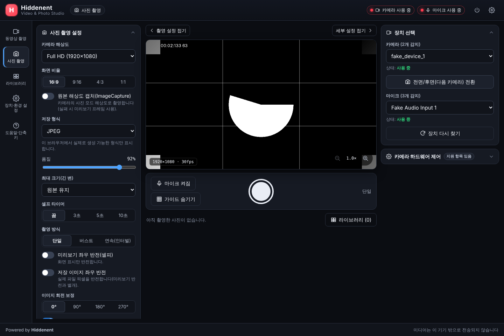
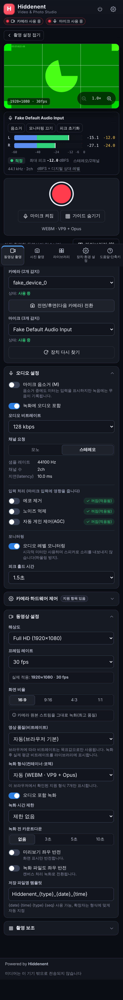
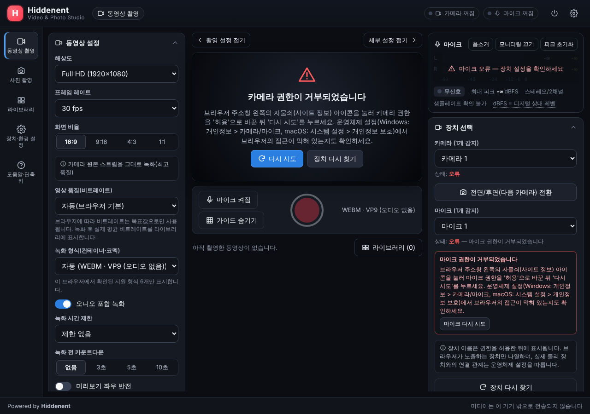

# 테스트 결과 보고서

## 검증 환경

- Chromium 141 (Playwright 번들, 헤드리스) — `--use-fake-device-for-media-stream=device-count=2,fps=30`
- 가짜 카메라 2대, 가짜 마이크 3개(Default / Input 1 / Input 2)
- 오디오 입력: 직접 생성한 스테레오 WAV(1 kHz, 왼쪽 -12 dBFS 피크, 오른쪽 -24 dBFS 피크) → L/R 분리 측정 검증
- 무신호 검증: 디지털 무음 WAV
- 권한 거부 검증: `--deny-permission-prompts`
- 모바일: 안드로이드(Galaxy UA)·아이폰(iPhone Safari UA) 390×844 터치 에뮬레이션, 카카오톡 인앱 UA, 공유 시트 모의 객체.
  아이폰의 실제 WebKit 엔진은 이 환경에 없어 실기기 검증이 필요하다.
- 두 번의 전체 실행 모두 49/49 통과. 이전에 간헐적으로 실패하던 '모바일 녹화' 항목의 원인은 녹화 시작 직후 정지 시
  인코더가 데이터를 내기 전이라 빈 파일이 되는 버그였으며(50 ms 후 정지 시 5회 중 3회 실패로 재현), 첫 데이터 대기로 수정 후
  10/10 성공하고 회귀 테스트(즉시 정지 3회)를 추가했다.
- 단위 테스트: Vitest 42건 (dBFS 계산, 미터 탄도, 코덱 선택, 제약 조건, 오류 메시지, 파일명, 색 행렬 등)

생성된 파일은 페이지 안에서 다시 열어 **바이트 시그니처**(WebM `1A45DFA3`, JPEG `FFD8`, PNG `89504E47`, ZIP `504B0304`),
**재생 가능 여부**(`<video>` 재생 후 currentTime 증가), **길이**(duration 메타데이터), **오디오 디코딩**(decodeAudioData 후 피크)
까지 확인했다. 다운로드는 실제 브라우저 다운로드 이벤트로 파일을 받아 디스크에서 다시 검사했다.

> 실제 USB 웹캠·물리 마이크·모바일 기기에서의 수동 검증은 이 클라우드 환경에서 수행할 수 없었다(아래 "실기기 검증 체크리스트" 참고).

## E2E 결과: 49/49 통과

| # | 항목 | 결과 | 시간 | 세부 |
|---|---|---|---|---|
| 1 | 브랜드 표기: Hiddenent / Video & Photo Studio / Powered by Hiddenent | ✅ | 0.2s |  |
| 2 | 권한 요청 전에는 카메라·마이크에 접근하지 않음 | ✅ | 0.0s |  |
| 3 | 카메라·마이크 시작 → 실시간 미리보기 표시 | ✅ | 0.2s | 실제 1920×1080 · 30fps |
| 4 | 카메라 목록 표시(권한 후 장치 이름 포함) | ✅ | 0.0s | fake_device_0, fake_device_1 |
| 5 | 마이크 목록 표시(드롭다운) | ✅ | 0.0s | Fake Default Audio Input, Fake Audio Input 1, Fake Audio Input 2 |
| 6 | 카메라 변경 시 기존 트랙 종료 후 미리보기가 새 장치로 전환 | ✅ | 0.1s | 328054… → eb0231… (이전 트랙 ended) |
| 7 | 오디오 레벨 미터: dBFS 수치·L/R 채널·구간 표시 갱신 | ✅ | 2.2s | L RMS -15 dBFS, R RMS -27 dBFS, L 피크 -12, 최대 -12, 구간=normal, 재측정 L=-15.0 |
| 8 | 피크 초기화 버튼 | ✅ | 0.5s | 초기화 직후 -∞, 0.5초 후 -12 |
| 9 | 마이크 변경 시 녹음 트랙·분석기 재구성 및 미터 반응 | ✅ | 1.5s | Fake Audio Input 1 선택, 활성 녹음 트랙 1개, 분석용 복제 트랙 1개, L=-15 dBFS |
| 10 | 지원하지 않는 프레임 레이트는 비활성화(잘못된 성공 표시 없음) | ✅ | 0.0s | 비활성: 50 fps — 장치 미지원, 60 fps — 장치 미지원 / 실제 적용: 1920×1080 · 30 fps |
| 11 | 하드웨어 제어: 브라우저가 노출한 항목만 표시 | ✅ | 0.1s | 노출/초점 모드 표시, 손떨림 보정은 "확인 불가(미지원)" 안내 |
| 12 | 동영상 녹화(3초, 오디오 포함) → 재생 가능한 파일 생성 | ✅ | 3.9s | 444776 bytes, sig=1a45dfa3, 1920×1080, 길이 3.10s, 재생 0.53s, 오디오 2ch 피크 0.254 |
| 13 | 동영상 파일 다운로드 | ✅ | 0.2s | Hiddenent_video_20261010_123822.webm (444776 bytes) |
| 14 | 녹화 일시정지/재개(일시정지 구간 제외) | ✅ | 5.6s | 일시정지 중 경과시간 고정(00:01), 파일 길이 2.54s (실제 경과 약 4.4s) |
| 15 | Space 단축키로 녹화 시작/종료 | ✅ | 1.7s | 항목 2 → 3 |
| 16 | 시작 직후 바로 정지해도 파일 생성(첫 데이터 대기) | ✅ | 2.8s | 즉시 정지 3회 → 파일 3개 (항목 3 → 6) |
| 17 | 입력창 편집 중에는 단축키 무시 | ✅ | 0.2s | 입력창에 p 입력 → 모드 전환 안 됨 |
| 18 | Esc: 녹화 중 확인 대화상자 → 녹화 취소(파일 미생성) | ✅ | 1.5s | 확인 전까지 녹화 유지, 취소 후 파일 없음 |
| 19 | 녹화 전 카운트다운(3초) 표시 및 Esc 취소 | ✅ | 3.4s | 카운트다운 표시 "3" → Esc 로 취소 |
| 20 | 화면 비율 1:1 → 정사각 파일 생성(카메라가 지원하면 원본, 아니면 캔버스 자르기) | ✅ | 4.1s | 1080×1080 · 카메라 원본 스트림을 그대로 녹화(최고 품질) |
| 21 | 파일 좌우 반전 → 캔버스 처리 녹화 파이프라인 | ✅ | 3.5s | 1920×1080, 길이 2.18s, 오디오 포함 · 캔버스 처리 녹화: 파일 좌우 반전 저장 |
| 22 | 오디오 제외 녹화 | ✅ | 2.6s | 오디오 트랙 없음 (decode: 실패=트랙 없음) |
| 23 | M 단축키 음소거 → 녹음은 무음, 미터는 입력 표시 | ✅ | 2.6s | 녹음 피크 0.00000(무음), 미터 L=-15 dBFS |
| 24 | 녹화 시간 제한(15초) 도달 시 자동 저장 | ✅ | 16.5s | 남은 시간 표시 "남은 시간 00:15", 파일 길이 15.03s |
| 25 | 녹화 중 카메라 연결 해제(ended 이벤트 시뮬레이션) → 자동 저장·안내 | ✅ | 1.8s | 안내 "카메라 연결이 끊어졌습니다" · 중단 시점까지 저장 · 다시 연결 성공 |
| 26 | P 단축키 → 사진 모드, 사진 촬영 및 미리보기 | ✅ | 0.4s | JPEG 1920×1080, 24145 bytes |
| 27 | 사진 파일 다운로드(JPEG) | ✅ | 0.2s | Hiddenent_photo_20261010_123913_001.jpg (24145 bytes) |
| 28 | PNG 형식 촬영 | ✅ | 0.5s | PNG 1920×1080, 58577 bytes |
| 29 | 원본 해상도 캡처(ImageCapture.takePhoto) | ✅ | 0.6s | 1920×1080, ImageCapture 사용 |
| 30 | 흑백 효과가 저장 사진 픽셀에 실제 적용 | ✅ | 0.6s | 최대 채널 차 0 (흑백), 미리보기 filter=url("#hid-color-matrix") |
| 31 | 버스트 촬영(5장) | ✅ | 1.6s | 5장 |
| 32 | 셀프 타이머 3초 촬영 | ✅ | 3.2s | 3.1초 후 촬영 |
| 33 | 촬영 후 편집: 90° 회전 적용 | ✅ | 0.5s | 1920×1080 → 1080×1920 |
| 34 | G 단축키로 구도 가이드 표시/숨기기 | ✅ | 0.0s | 표시 → 숨김 → 표시 |
| 35 | 라이브러리: 사진/동영상 필터, 메타데이터 표시 | ✅ | 0.2s | 전체 22 = 사진 10 + 동영상 12; 카드: 00:01 / Hiddenent_video_20261010_123911.webm / 동영상 / 임시(메모리) / 1920×1080 · 193 KB / 2026-10-10 12:39:11 |
| 36 | 라이브러리: 다중 선택 → ZIP 일괄 다운로드 | ✅ | 0.2s | Hiddenent_20261010_1239_2files.zip (55477 bytes) |
| 37 | 라이브러리: 이름 변경 | ✅ | 0.2s | 내 테스트 파일.jpg |
| 38 | 로컬 영구 저장(IndexedDB) 후 새로고침해도 유지, 임시 파일은 구분 | ✅ | 0.4s | 저장 1 / 임시 21 → 새로고침 후 1개(내 테스트 파일.jpg) · 이탈 경고 표시됨 |
| 39 | 파일 삭제 전 확인 후 삭제(로컬 저장소 포함) | ✅ | 0.4s | 삭제 후 새로고침해도 비어 있음 |
| 40 | 카메라·마이크 사용 종료 시 모든 트랙·오디오 분석기 정리 | ✅ | 1.5s | 트랙 2개 모두 종료, 분석 복제 트랙 0, 열린 AudioContext 0 |
| 41 | 데스크톱 레이아웃 스크린샷 | ✅ | 2.3s | desktop-video.png, desktop-photo.png |
| 42 | 모바일 레이아웃(390×844): 하단 탭, 가로 스크롤 없음, 미터 표시 | ✅ | 3.5s | nav=fixed, 미리보기 폭 366px, 미터 표시, 모바일 녹화 OK |
| 43 | 모바일: 카카오톡 인앱 브라우저 감지 → 외부 브라우저 열기 안내 | ✅ | 0.8s | 안내 표시, 버튼 → kakaotalk://web/openExternal?url=http%3A…; 일반 iPhone Safari UA 에서는 미표시 |
| 44 | 모바일(아이폰 UA): 녹화 → 공유 시트로 사진 앱 저장 | ✅ | 3.0s | 공유 파일 Hiddenent_video_20261010_123931.webm (video/webm;codecs=vp9,opus, 214143 bytes) |
| 45 | 모바일: 지원 형식을 하나도 보고하지 않는 브라우저에서도 기본 형식으로 녹화 | ✅ | 2.9s | "브라우저 기본 형식(녹화 후 확인)" → Hiddenent_video_20261010_123933.webm, 216690 bytes, 재생·오디오 확인 |
| 46 | 모바일: 앱 전환으로 끊긴 카메라를 화면 복귀 시 자동 재연결 | ✅ | 0.5s | 연결 끊김 표시 → 화면 복귀 시 버튼 없이 재연결 |
| 47 | 콘솔 오류 없음 | ✅ | 0.0s |  |
| 48 | 오디오 입력이 없으면 무신호 상태 표시 | ✅ | 2.9s | "무신호 (입력 없음)", RMS -∞ |
| 49 | 권한 거부 시 원인과 해결 방법 안내 | ✅ | 0.4s | 카메라 권한이 거부되었습니다 /  |

## 스크린샷

| 데스크톱 · 동영상 | 데스크톱 · 사진 |
|---|---|
|  |  |

| 모바일(390×844) | 권한 거부 안내 |
|---|---|
|  |  |

## 실기기 검증 체크리스트 (배포 후 수행 권장)

- [ ] Windows/macOS Chrome·Edge: 내장 웹캠 + USB 웹캠 전환, USB 마이크 선택 시 미터 반응
- [ ] macOS Safari: MP4(H.264/AAC) 기본 선택, 녹화 파일 QuickTime 재생
- [ ] Firefox: WebM 녹화, getCapabilities 미지원 시 해상도 옵션 표시
- [ ] Android Chrome / iOS Safari: 전면·후면 전환, 세로(9:16) 녹화, 백그라운드 전환 시 안내
- [ ] 녹화 중 USB 마이크/카메라 물리적 분리 → 자동 저장 및 안내
- [ ] 큰 파일(10분 이상) 녹화 후 IndexedDB 보관 시 용량 경고
